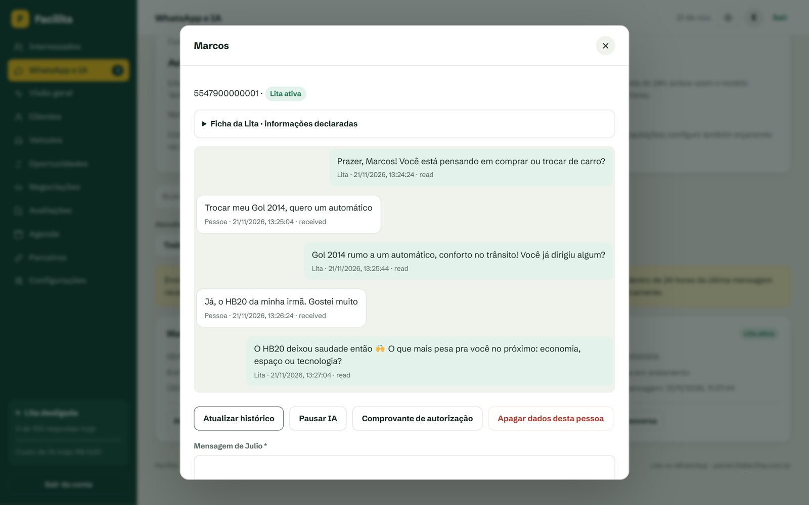
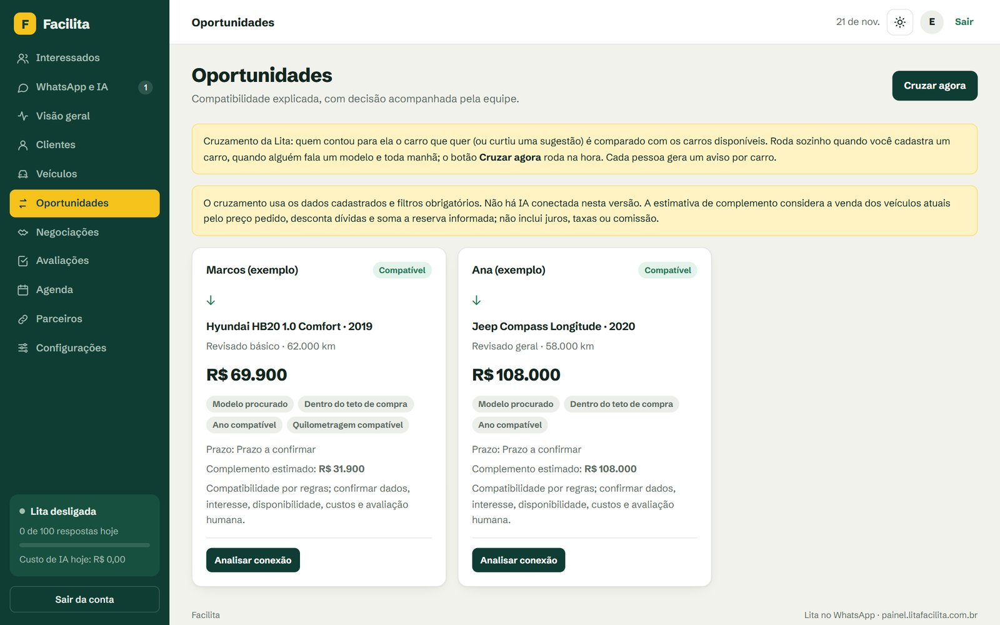
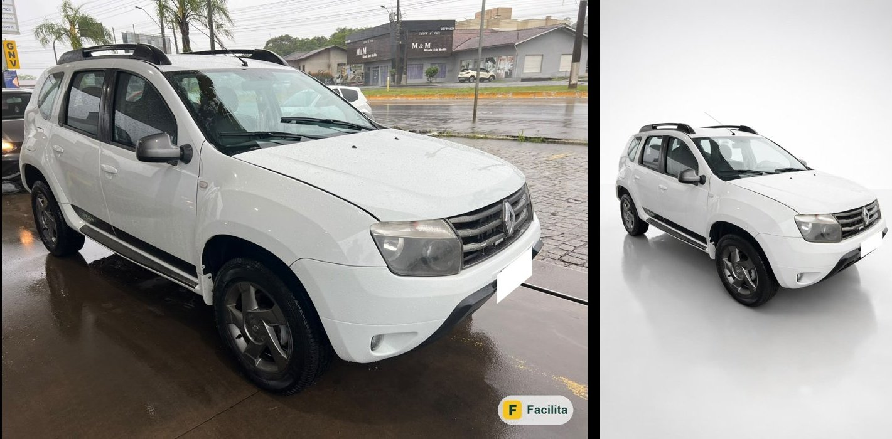
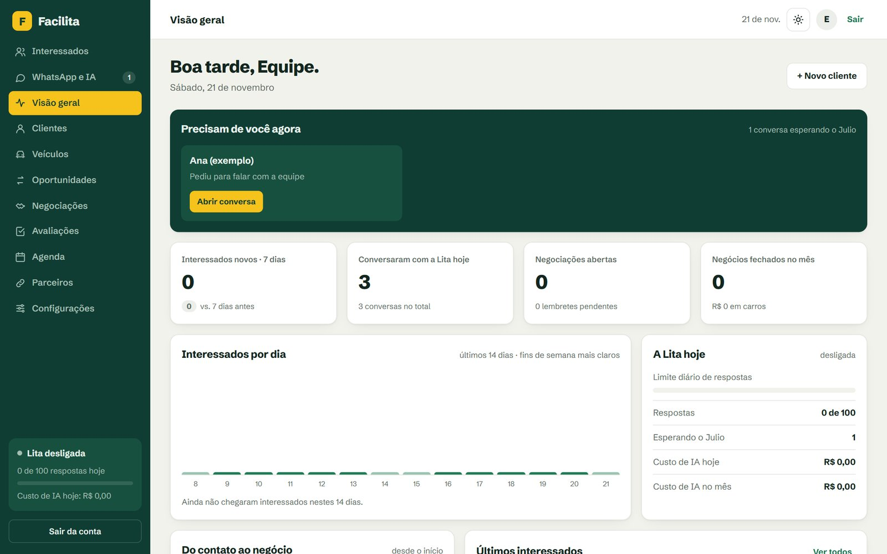
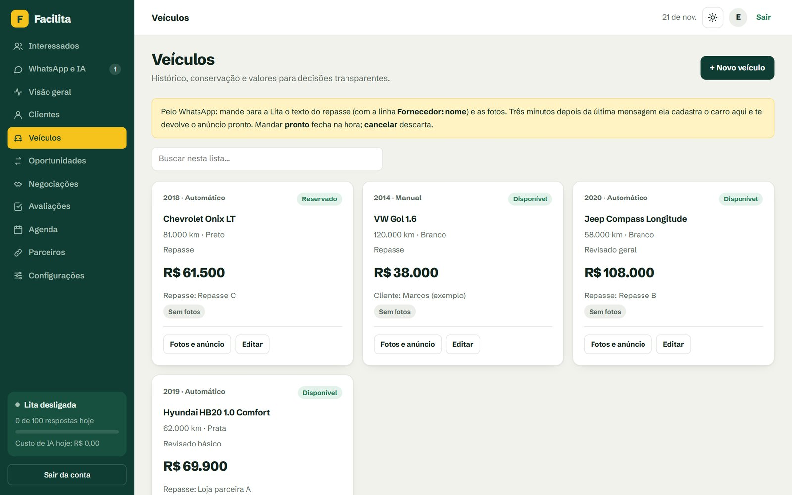

# Facilita: Lita, a assistente de carros no WhatsApp

**Atendimento por IA no WhatsApp, CRM de veículos e gerador de anúncios para uma intermediadora de carros de Blumenau/SC.**

Site no ar: **[litafacilita.com.br](https://litafacilita.com.br)**

A Facilita Soluções Automotivas ajuda pessoas a comprar, vender e trocar carros na região de Blumenau. Quem tem interesse manda um "oi" no WhatsApp e é atendido pela **Lita**, uma assistente virtual que conversa como alguém da equipe, entende o que a pessoa procura e monta uma ficha completa. Do outro lado, o dono da empresa acompanha tudo num **painel web**: conversas, clientes, carros disponíveis, combinações entre quem procura e quem vende, negociações e anúncios prontos para publicar.

O sistema está em produção, atendendo clientes reais, e foi construído do zero em cerca de duas semanas, com mudanças quase diárias a partir do retorno do cliente (áudios, prints e testes no WhatsApp).



*Todas as telas do painel desta página usam dados fictícios.*

---

## Como funciona

```
 Cliente no WhatsApp ──► API do WhatsApp (Meta) ──► servidor Facilita ──► IA (OpenAI)
                                                        │      ▲               │
                                                        │      └── ficha + resposta (JSON validado)
                                                        ▼
                                SQLite: conversas, fichas, clientes, veículos, negociações
                                                        │
                       Painel web (equipe)  ◄───────────┴──────────►  Cruzamento diário
                                                                       (quem procura × carros disponíveis)
```

### 1. A Lita conversa no WhatsApp

- Cada mensagem chega por **webhook da API oficial do WhatsApp (Meta)**, com a assinatura conferida antes de qualquer processamento e deduplicação, para a mesma mensagem nunca ser respondida duas vezes.
- A Lita **espera alguns segundos** antes de responder: se a pessoa manda três mensagens seguidas, recebe uma resposta só, que considera tudo.
- **Áudios** são transcritos automaticamente e tratados como texto.
- A conversa segue um método consultivo: retoma em poucas palavras o que a pessoa disse e faz **uma pergunta por vez** (carro atual, uso no dia a dia, o que quer no próximo, prazo, orçamento, se aceita leilão...). Regras no código evitam vícios de robô: pergunta repetida, a mesma expressão em toda mensagem, mensagens longas demais.
- Antes de coletar dados, a Lita mostra o **aviso de privacidade (LGPD)** e guarda o comprovante do consentimento. A pessoa pode pedir para parar a qualquer momento, e o painel tem um botão para apagar todos os dados dela.
- Se a pessoa pedir para falar com alguém, a Lita **passa a conversa para a equipe** e o dono recebe um aviso no próprio WhatsApp.

### 2. A ficha se monta sozinha

A IA não devolve só texto: cada resposta vem num **JSON com esquema fixo** (Structured Outputs) contendo a mensagem para o cliente e as atualizações da ficha: nome, cidade, carros atuais (marca, modelo, ano, km, câmbio, conservação), modelos desejados, prioridades, restrições e prazo. O servidor valida e mescla essas atualizações com regras próprias (um apelido não apaga o nome completo, listas corrigidas substituem as antigas) antes de gravar.

### 3. Combinações entre quem procura e quem vende

Quando um carro é cadastrado, quando alguém cita um modelo e todas as manhãs, o sistema **cruza a base**: cada pessoa é comparada com os carros disponíveis por regras explicáveis (modelo procurado, teto de compra, ano mínimo, quilometragem, câmbio, conservação) e o painel mostra o porquê de cada combinação. A decisão final é sempre humana.



### 4. Anúncio pronto a partir de fotos do celular

O dono manda as fotos do carro pelo WhatsApp e o sistema monta o anúncio:

1. **Detecta a placa** (YOLOv9) e verifica se a foto é do carro por fora (RF-DETR). Tudo roda no servidor: nenhuma foto sai sem a placa coberta.
2. Refaz a foto em **estúdio profissional** com IA de imagem, mantendo o carro exatamente como é, inclusive riscos e amassados. Se a IA falhar, entra um recorte local (rembg) sobre um estúdio desenhado com sombra e reflexo.
3. Gera o **pôster vertical** para status e redes, com a marca do carro, os destaques e o preço.

Cada foto refeita é guardada pela impressão digital (SHA-256), então a mesma foto nunca é paga duas vezes, e o custo de IA aparece no painel.

| Foto original → estúdio | Pôster gerado |
|---|---|
|  |  |

### 5. Painel da equipe

Visão geral do dia, conversas que precisam de atenção, clientes, veículos com fotos, oportunidades, negociações, avaliações, agenda e parceiros. Funciona no celular, tem modo escuro e área separada para clientes (cada um vê só os próprios dados).

| Visão geral | Veículos |
|---|---|
|  |  |

### 6. Site público

O site leva as pessoas para a Lita e oferece ferramentas: consulta da **Tabela FIPE ao vivo**, simulação de parcela, custo mensal do carro, etanol ou gasolina, checklist de vistoria e guia de documentação.

| Computador | Celular |
|---|---|
|  |  |

---

## Como foi programado

### Tecnologias

          

### Decisões de arquitetura

- **Backend sem dependências externas.** O servidor usa só a biblioteca padrão do Node.js 24: `node:http` para a API, `node:sqlite` para o banco, `node:crypto` para senhas (scrypt), sessões e verificação de assinaturas. Nenhum pacote do npm, o que reduz a superfície de ataque e simplifica a manutenção.
- **Front-end em JavaScript puro**, sem framework: HTML, CSS com variáveis de tema (claro e escuro) e um único `app.js` para o painel. Fonte embutida e Content Security Policy restrita.
- **IA com saída estruturada.** O comportamento da Lita fica num prompt detalhado (tom, formato para WhatsApp, o que nunca prometer) e a resposta é forçada a seguir um JSON Schema. O código, e não a IA, decide o que vai para o banco, quando mostrar o aviso de privacidade, quando passar para a equipe e quando parar.
- **Controle de custo de IA.** Limite diário de respostas e de fotos, cache do prompt, cache das fotos por hash e custo calculado por mensagem e exibido no painel.
- **Pipeline de imagem em Python** (Pillow, NumPy, rembg e detectores ONNX abertos) chamado pelo Node como processo separado, com fila, tempo limite e alternativa local quando a IA de imagem não responde.
- **Privacidade desde o início.** Consentimento com versão e comprovante, apagamento sob pedido, placa coberta antes de qualquer envio, número do dono e chaves fora do repositório.

### Infraestrutura e publicação

- Servidor Linux (VPS) com **systemd** e **Caddy** (HTTPS automático) servindo o site, o painel e o webhook.
- **Publicação contínua com GitHub Actions:** a cada envio para `main`, os testes rodam e, se passarem, um pacote é enviado por SSH. A chave de publicação só consegue executar um script de implantação, que confere os arquivos, coloca o sistema em manutenção, espera a fila de mensagens esvaziar, faz backup, reinicia, testa a saúde e **volta para a versão anterior sozinho** se algo der errado.
- **Backup diário criptografado** (AES-256 com chave protegida por RSA) enviado para um repositório externo, além do backup local das fotos.

### Testes

- Cerca de **130 testes automatizados** (`node --test`) cobrindo regras de negócio, permissões, webhook, formato das mensagens, cadastro de veículos, anúncios e migração do banco.
- **Testes em navegador** com Playwright (painel no computador e no celular, conversas, anúncios, área do cliente), com banco temporário e APIs simuladas.
- **Simulador da Lita**: reproduz conversas reais contra a IA de verdade para conferir o comportamento antes de publicar uma mudança no prompt.

### Processo

O cliente mandava áudios, prints e mensagens de WhatsApp com o que queria mudar; cada pedido virava uma alteração pequena, testada e publicada no mesmo dia, com o motivo registrado no histórico. Foram mais de 80 versões publicadas nas duas primeiras semanas, incluindo seis gerações do gerador de fotos de estúdio até chegar no padrão de loja que o cliente pediu.

---

## Criador

**João Gabriel Dal Vesco Smaniotto**: levantamento de requisitos com o cliente, arquitetura, desenvolvimento, infraestrutura e suporte.

- E-mail: [jgdalvesco@gmail.com](mailto:jgdalvesco@gmail.com)

---

Desenvolvido para a Facilita Soluções Automotivas. As telas do painel mostradas aqui usam dados fictícios; as fotos de veículos são de anúncios públicos da empresa, com a placa coberta.

Este repositório apresenta o sistema; o código-fonte não é público.
© 2026 João Gabriel Dal Vesco Smaniotto. Todos os direitos reservados.
